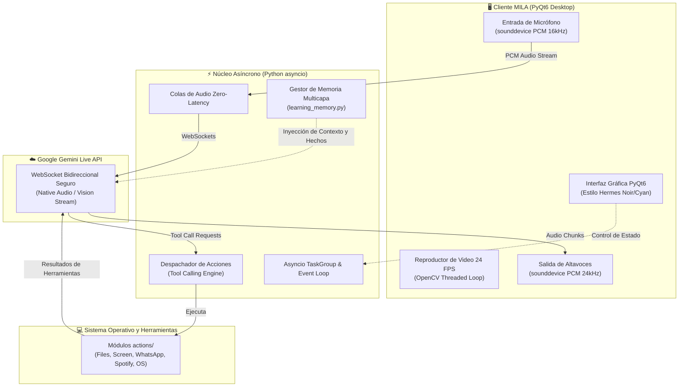

<div align="center">


# 🤖 M.I.L.A
### **Mi Inteligencia de Lenguaje Avanzada**
*Asistente de Escritorio Multimodal en Tiempo Real (Voz, Visión, Automatización y Agente Autónomo)*

[](https://www.python.org/)
[](https://aistudio.google.com/)
[](https://riverbankcomputing.com/software/pyqt/)
[](aws/deploy_guide.md)
[](https://github.com/)

**Desarrollado con ❤️ por Jesús Cantillo**

---

<p align="center">
  <a href="#-1-cómo-es-mila-identidad-y-diseño">¿Cómo es MILA?</a> •
  <a href="#-2-qué-hace-mila-capacidades-clave">¿Qué hace MILA?</a> •
  <a href="#-3-para-qué-sirve-mila-propuesta-de-valor">¿Para qué sirve?</a> •
  <a href="#-4-cómo-funciona-mila-arquitectura-técnica">¿Cómo funciona?</a> •
  <a href="#-5-sistema-de-entrenamiento-y-aprendizaje">Entrenamiento</a> •
  <a href="#-6-despliegue-en-la-nube-aws">Despliegue AWS</a> •
  <a href="#-7-instalación-rápida-local">Instalación</a>
</p>

</div>

---

## 💎 1. ¿Cómo es MILA? (Identidad y Diseño)

**MILA** está concebida no como un simple programa de chat, sino como un **copiloto interactivo con presencia viva**, inspirado en los estándares de diseño más exigentes (estética tipo *Hermes Desktop*):

<div align="center">
  
</div>

* **Estética Cyber-Minimalista:** Paleta de colores *Dark Obsidian* (`#0b0f17`) con acentos en *Azul Cyan Neón* (`#00f0ff`) y tarjetas translúcidas con bordes refinados.
* **Presencia Visual Reactiva (Avatar en Video 24 FPS):**
  * **Modo Escucha / Reposo:** Bucle de video fluido en alta resolución (`mila_idle.mp4`) mientras te escucha en segundo plano.
  * **Modo Habla / Sincronía Labial:** Transición automática a video con movimiento de labios activo (`mila_speaking.mp4`) cuando responde verbalmente.
  * **Video sin Audio Embebido:** Decodificado fotograma a fotograma con OpenCV puro; no contamina ni interrumpe el canal de audio de la voz nativa.
* **Tres Modos de Visualización Adaptables:**
  * 🪟 **Modo Dividido (Default):** Avatar en la sección superior y panel de conversación interactivo en la sección inferior.
  * 🎙️ **Solo Mila:** Foco inmersivo total en el avatar para interacción 100% manos libres por voz.
  * 💬 **Solo Chat:** Expansión completa de la consola de mensajes, tarjetas de herramientas y visor de documentos.
* **Telemetría y Retroalimentación Sensorial:**
  * Visualizador dinámico de ondas sonoras (*audio waveform*) reactivo a los decibelios de la voz.
  * Indicador de estado del micrófono en tiempo real (*Escuchando en verde / Silenciado en rojo*).

---

## ⚡ 2. ¿Qué hace MILA? (Capacidades Clave)

MILA integra procesamiento cognitivo, visión artificial y automatización directa del sistema operativo en un solo flujo continuo:

| Capacidad | Descripción |
|---|---|
| 🎙️ **Voz Nativa Bidireccional** | Conversación oral en español natural con latencia ultrabaja (< 500 ms) e **interrupción orgánica** (puedes interrumpirla en cualquier momento y se adapta al instante). |
| 👁️ **Visión de Pantalla en Vivo** | Inspecciona lo que estás viendo en tus monitores para ayudarte a resolver errores de código, analizar diagramas o resumir páginas web abiertas. |
| 📁 **Procesamiento de Archivos (Drag & Drop)** | Arrastra cualquier archivo (PDF, Word, Excel, CSV, código fuente, imágenes) a la ventana de MILA y pregúntale por voz lo que necesites sintetizar. |
| 🖥️ **Control Integral del Sistema** | Ajusta volumen, brillo de pantalla, WiFi, modo oscuro, captura de pantalla, bloqueo y reinicio de tu computadora. |
| 💬 **Mensajería Automatizada** | Envía y supervisa mensajes a través de WhatsApp Desktop y Telegram sin tocar el teclado. |
| 🎵 **Control Multimedia** | Reproduce canciones, playlists y gestiona tu reproducción en Spotify y videos en YouTube. |
| 💻 **Asistente de Programación** | Escribe, analiza, explica y ejecuta código en múltiples lenguajes de programación en vivo. |
| 🛒 **Asistente de Compras y Vuelos** | Compara precios de productos en Amazon, MercadoLibre, eBay o busca vuelos en tiempo real en Google Flights. |
| 🌐 **Búsqueda Web en Tiempo Real** | Consulta noticias, clima y datos actualizados de internet al instante. |

---

## 🎯 3. ¿Para qué sirve MILA? (Propuesta de Valor)

* **Eliminación de la Fricción Laboral:** Los profesionales pierden entre un 20% y un 30% de su jornada cambiando entre decenas de ventanas, buscando archivos y copiando información. MILA actúa como el centro de control que ejecuta esas tareas por ti.
* **Síntesis Inmediata de Documentos Extensos:** En lugar de detenerte a leer un reporte técnico o contrato de 40 páginas, sueltas el archivo en MILA y dices: *«Mila, resume los tres riesgos principales y los hitos de entrega»*. Tienes la respuesta hablada y escrita en 30 segundos.
* **Multitarea Real Manos Libres:** Trabaja en tu editor de código, software de diseño o videojuego mientras le pides a MILA que redacte un mensaje, busque una documentación o ajuste la música sin soltar el teclado o mouse.
* **Asistente Corporativo y Personal:** Configurable para atender requerimientos de soporte interno, consultas a bases de datos SQL (`db_reader`) y gestión de recordatorios.

---

## 🧠 4. ¿Cómo funciona MILA? (Arquitectura Técnica)

MILA está construida sobre una arquitectura modular asíncrona de alto rendimiento que conecta flujos de audio PCM en tiempo real con modelos fundacionales multimodales:



### Principios de Ingeniería del Núcleo:
1. **Conexión Persistente Bidireccional:** Comunicación full-duplex vía WebSockets con la API nativa de audio de Gemini. El audio fluye continuamente en paquetes PCM de 16 kHz hacia el servidor y regresa a 24 kHz hacia el reproductor.
2. **Concurrencia Robusta con `asyncio.TaskGroup`:** El envío de audio, recepción de respuestas, renderizado gráfico y ejecución de herramientas se procesan en corrutinas desacopladas para evitar bloqueos.
3. **Decodificación de Video Desacoplada:** El reproductor `VideoLoopPlayer` procesa fotogramas de `mila_idle.mp4` y `mila_speaking.mp4` en un subproceso aislado, evitando caídas de cuadros (*frame drops*) incluso durante tareas pesadas de CPU.

---

## 🎓 5. Sistema de Entrenamiento y Aprendizaje

MILA cuenta con una arquitectura de entrenamiento en **4 capas** para especializarse en dominios específicos (médico, legal, empresarial o personal):

```
┌──────────────────────────────────────────────────────────────────┐
│  Capa 1: Personalidad y Directrices (core/prompt.txt)             │
├──────────────────────────────────────────────────────────────────┤
│  Capa 2: Aprendizaje Continuo en Tiempo Real (memory/)           │
├──────────────────────────────────────────────────────────────────┤
│  Capa 3: Ingesta de Conocimiento RAG (training/train_knowledge)  │
├──────────────────────────────────────────────────────────────────┤
│  Capa 4: Fine-Tuning Supervisado SFT (training/dataset_generator)│
└──────────────────────────────────────────────────────────────────┘
```

### 1. Ingesta Rápida de Conocimiento (Empresarial / Manuales)
Para entrenar a MILA con los documentos de tu empresa o proyectos:
1. Coloca tus archivos (`.txt`, `.md`, `.json`) en la carpeta `training/data/`.
2. Ejecuta el entrenador:
   ```bash
   python training/train_knowledge.py
   ```
MILA extraerá conceptos, políticas y preguntas frecuentes, indexándolos inmediatamente en `memory/learning_data.json`. ¡Estará lista para responder sobre ellos por voz!

### 2. Fine-Tuning Supervisado (SFT) en la Nube
Para ajustar finamente un modelo en **Google Cloud Vertex AI** o **AWS Bedrock**:
1. Genera el dataset en formato JSONL estándar:
   ```bash
   python training/dataset_generator.py
   ```
2. El archivo generado `training/mila_sft_dataset.jsonl` contiene turnos multi-rol optimizados para afinar modelos con la personalidad y funciones de MILA.

> Para más detalles, consulta la [Guía Completa de Entrenamiento](training/README.md).

---

## ☁️ 6. Despliegue en la Nube (AWS)

MILA está completamente preparada para su despliegue en **Amazon Web Services**, permitiendo ejecutar el asistente como servicio en la nube con respaldo persistente en S3.

```
       ┌────────────────────────┐
       │     AWS EC2 / ECS      │
       │   Contenedor Docker    │ ───► Respaldo automático ───►  Amazon S3 Bucket
       │ (Xvfb + ALSA Emulation)│       (s3_backup.py)         (Memoria Persistente)
       └────────────────────────┘
```

### Recursos de AWS incluidos en la carpeta [`aws/`](aws/):
* 🐳 **`aws/Dockerfile`:** Imagen Docker optimizada con Python 3.11, PortAudio, Xvfb (display virtual) y Chromium Playwright.
* 🐙 **`aws/docker-compose.yml`:** Orquestación con persistencia de volúmenes de memoria y configuración de entorno.
* ☁️ **`aws/ecs-task-definition.json`:** Definición de tarea lista para desplegar en **AWS ECS Fargate**.
* 📜 **`aws/setup_aws_ec2.sh`:** Script bash de un solo paso para aprovisionar instancias Ubuntu en EC2.
* 🗄️ **`aws/s3_backup.py`:** Utilidad para respaldar y restaurar la memoria de MILA en Amazon S3.

### Despliegue rápido en AWS EC2:
```bash
# 1. En tu servidor EC2 (Ubuntu 22.04 / 24.04):
git clone <URL_REPOSITORIO>
cd MILA-main

# 2. Aprovisionar servidor (Docker, audio, Xvfb):
chmod +x aws/setup_aws_ec2.sh
./aws/setup_aws_ec2.sh

# 3. Configurar credenciales:
cp .env.example .env
nano .env

# 4. Iniciar contenedor:
cd aws
docker compose up -d --build
```

> Para ver la guía de configuración paso a paso, revisa la [Guía de Despliegue en AWS](aws/deploy_guide.md).

---

## 🚀 7. Instalación Rápida (Local)

### Requisitos previos:
* **Python 3.11 o 3.12** ([python.org/downloads](https://www.python.org/downloads/))
* **API Key de Google Gemini** (Gratuita en [aistudio.google.com](https://aistudio.google.com))
* Micrófono y altavoces conectados.

### Paso 1: Clonar el repositorio
```bash
git clone https://github.com/yisus0708/MILA-main.git
cd MILA-main
```

### Paso 2: Configurar la API Key
Copia la plantilla de configuración y coloca tu API Key de Gemini:
```bash
# Opción A: Archivo JSON
cp config/api_keys.json.example config/api_keys.json
# Edita config/api_keys.json con tu clave

# Opción B: Archivo .env
cp .env.example .env
```

### Paso 3: Instalar dependencias
**En Windows:**
```bash
pip install -r requirements.txt
playwright install chromium
```

**En Linux (Ubuntu/Debian):**
```bash
sudo apt update && sudo apt install -y portaudio19-dev ffmpeg libasound2-dev
pip install -r requirements.txt
playwright install chromium
playwright install-deps chromium
```

**En macOS:**
```bash
brew install portaudio ffmpeg
pip install -r requirements.txt
playwright install chromium
```

### Paso 4: Iniciar MILA
```bash
python main.py
```
*En cuanto el indicador muestre **"CONECTADO"** y el micrófono esté activo en verde, ¡ya puedes hablarle directamente a MILA!*

---

## 📂 8. Estructura del Repositorio

```
MILA-main/
├── main.py                     # Punto de entrada principal y orquestador async
├── ui.py                       # Interfaz gráfica moderna en PyQt6 (Estilo Hermes)
├── requirements.txt            # Dependencias del proyecto
├── .env.example                # Variables de entorno de ejemplo
├── .gitignore                  # Exclusiones de Git (seguridad y archivos temporales)
│
├── assets/                     # Recursos visuales y multimedia
│   ├── mila_logo_cyan.png      # Logo oficial de MILA en neon cyan
│   ├── mila_avatar.png         # Arte conceptual del avatar
│   ├── mila_idle.mp4           # Video bucle de MILA en reposo (escucha activa)
│   └── mila_speaking.mp4       # Video bucle de MILA hablando (lip-sync)
│
├── actions/                    # Módulos modulares de ejecución de herramientas
│   ├── file_processor.py       # Procesamiento y resumen inteligente de documentos
│   ├── screen_processor.py     # Captura e inspección visual de pantalla
│   ├── computer_settings.py    # Control de hardware y sistema operativo
│   ├── send_message.py         # Integración de mensajería (WhatsApp / Telegram)
│   ├── spotify_control.py      # Control de reproducción de Spotify
│   ├── youtube_video.py        # Búsqueda y streaming de YouTube
│   ├── web_search.py           # Búsqueda en la web
│   └── code_helper.py          # Asistente de programación y depuración
│
├── agent/                      # Motor de planificación para tareas complejas
│   ├── planner.py              # Generador de planes de ejecución multi-paso
│   └── executor.py             # Ejecutor secuencial de tareas
│
├── core/                       # Lógica central del sistema
│   └── prompt.txt              # Personalidad, directrices y reglas del sistema
│
├── memory/                     # Sistema de memoria persistente
│   ├── learning_memory.py      # Gestor de hechos aprendidos y correcciones
│   ├── memory_manager.py       # Gestor de memoria a largo plazo
│   └── learning_data.json      # Base de datos local de conocimiento
│
├── training/                   # Módulo de entrenamiento y especialización
│   ├── README.md               # Guía técnica de entrenamiento y capas
│   ├── train_knowledge.py      # Script de ingesta de manuales y documentos
│   ├── dataset_generator.py    # Generador de datasets para Fine-Tuning (SFT)
│   └── sample_training_data.jsonl # Ejemplo de dataset formateado
│
└── aws/                        # Infraestructura y despliegue en la nube
    ├── Dockerfile              # Contenedor para ejecución en AWS (Xvfb + Audio)
    ├── docker-compose.yml      # Orquestación con persistencia de volúmenes
    ├── setup_aws_ec2.sh        # Aprovisionamiento automatizado en EC2
    ├── ecs-task-definition.json # Definición de tarea para AWS ECS Fargate
    ├── s3_backup.py            # Utilidad de sincronización de memoria con Amazon S3
    └── deploy_guide.md         # Manual paso a paso de despliegue en AWS
```

---

## 🛡️ 9. Seguridad y Privacidad

* **Privacidad Local:** Las interacciones se procesan en la memoria de tu máquina. MILA no transmite tus archivos a servidores de terceros para almacenamiento permanente.
* **Protección de Credenciales:** Las API Keys y credenciales de bases de datos se mantienen en archivos locales excluidos del control de versiones mediante `.gitignore`.
* **Cero Filtración de Datos:** Los archivos cargados mediante *drag & drop* se analizan temporalmente y se liberan de memoria tras generar la síntesis.

---

<div align="center">

### 🌟 M.I.L.A — Diseñada para la nueva era de la Inteligencia Artificial
*Transformando la complejidad técnica en una conversación humana simple.*

**Desarrollado por Jesús Cantillo**

</div>
